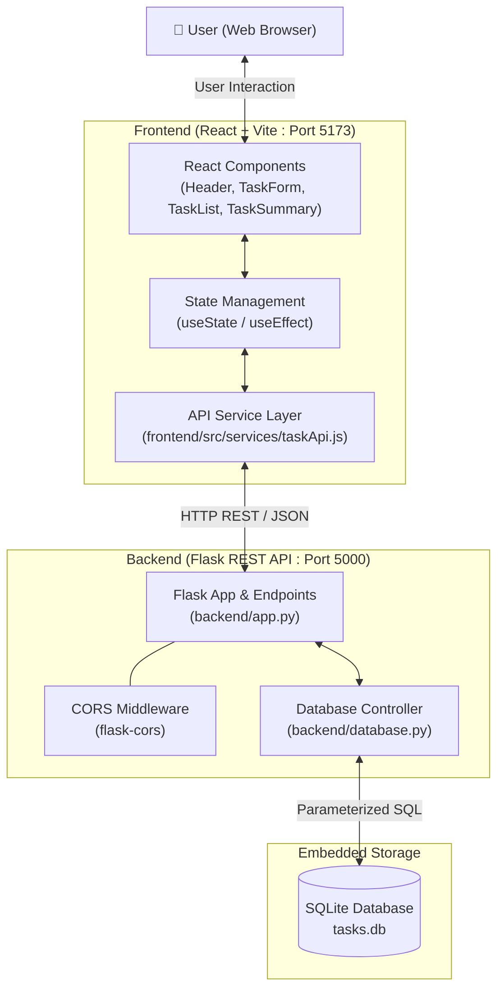
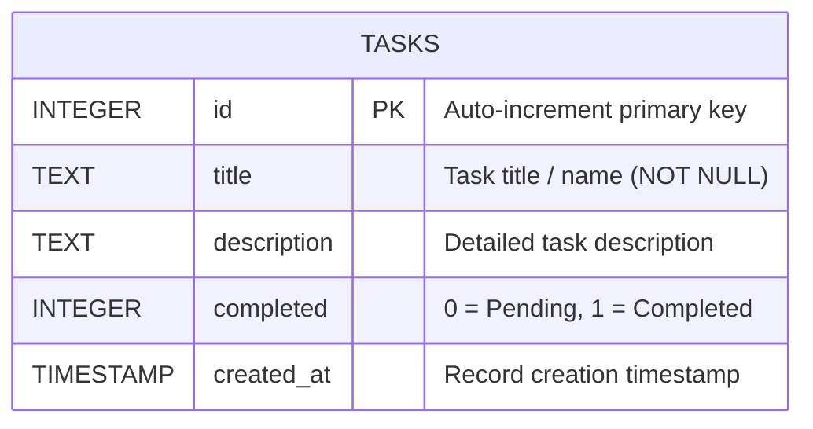

# TaskFlow ⚡

A modern, responsive full-stack task management application designed for productivity, simplicity, and speed. Built with a decoupled architecture featuring a **React (Vite)** frontend, a **Python Flask REST API**, and an embedded **SQLite** database.

---

## 🌟 Key Features

- **📊 Dynamic Metric Dashboard**: Real-time summary cards displaying Total, Pending, and Completed tasks with auto-updating metrics.
- **✨ Full Task Lifecycle (CRUD)**:
  - **Create**: Add new tasks with title validation and optional descriptions.
  - **Read**: View all tasks sorted by creation date with status badges.
  - **Update**: In-place task editing modal with title & description updating.
  - **Complete / Toggle**: One-click completion toggle with visual strikethrough.
  - **Delete**: Instant task removal with SQLite synchronization.
- **🎨 Glassmorphic Dark UI**: Custom Vanilla CSS design system with sleek backdrop blurs, fluid micro-interactions, responsive grids, and subtle gradients.
- **🛡️ Secure Parameterized SQL**: All queries use `?` placeholders to eliminate SQL injection vulnerabilities.
- **⚡ Automatic Database Initialization**: Automatically creates `tasks.db` and the `tasks` table on server startup, seeding starter tasks if the database is fresh.
- **🔄 Robust Error Handling & Retry**: Built-in loading states, visual spinner, inline input validation, and an error notification banner with one-click retry.

---

## 🏗️ Architecture Overview



---

## 💻 Tech Stack

| Layer | Technologies |
|---|---|
| **Frontend** | React 19, Vite, Vanilla CSS3, JavaScript (ES6+), Fetch API |
| **Backend** | Python 3, Flask, Flask-CORS, Werkzeug |
| **Database** | SQLite3 (Embedded, zero-config relational database) |
| **Tooling & Env** | Node.js, npm, Python Virtual Environment (`venv`), Git |

---

## 📁 Project Directory Structure

```text
TaskFlow/
├── README.md                 # Public GitHub documentation (this file)
├── .gitignore                # Production Git exclusion configuration
├── package.json              # Root npm script runner
├── app.py                    # Root convenience launcher for Flask backend
├── vedika.md                 # Technical engineering & architecture documentation
├── backend/
│   ├── app.py                # Main Flask REST API server & routes
│   ├── database.py           # SQLite connection, init_db(), & schema setup
│   ├── requirements.txt      # Python dependencies (flask, flask-cors)
│   └── tasks.db              # Embedded SQLite database (auto-generated)
└── frontend/
    ├── index.html            # Main HTML document
    ├── package.json          # Node dependencies and scripts
    ├── vite.config.js        # Vite dev server and proxy configuration
    └── src/
        ├── main.jsx          # React DOM entry point
        ├── App.jsx           # Root application state & layout
        ├── App.css           # Component styles & dark-mode theme
        ├── index.css         # Global design tokens & CSS resets
        ├── services/
        │   └── taskApi.js    # Reusable Fetch API network module
        └── components/
            ├── Header.jsx        # Application branding & live date
            ├── TaskSummary.jsx   # Metric summary cards (Total/Pending/Done)
            ├── TaskForm.jsx      # Task creation form with validation
            ├── TaskList.jsx      # Task container & filter navigation tabs
            ├── TaskItem.jsx      # Task card with toggle, edit, & delete
            └── EditTaskModal.jsx # Task editing popup modal
```

---

## 🔌 REST API Endpoints Contract

All API endpoints accept and return `application/json`:

| HTTP Method | Endpoint | Aliases | Description | Payload Example |
|---|---|---|---|---|
| `GET` | `/` | `/api` | Root API directory & health index | *None* |
| `GET` | `/api/health` | `/health` | Server health status check | *None* |
| `GET` | `/api/tasks` | `/tasks` | Retrieve all tasks & summary counts | *None* |
| `POST` | `/api/tasks` | `/tasks` | Create a new task | `{"title": "...", "description": "..."}` |
| `PUT` | `/api/tasks/<id>` | `/tasks/<id>` | Update title, description, or status | `{"title": "...", "completed": true}` |
| `PATCH` | `/api/tasks/<id>/complete` | `/tasks/<id>/complete` | Toggle task completion flag | `{"completed": true}` *(optional)* |
| `DELETE` | `/api/tasks/<id>` | `/tasks/<id>` | Permanently delete a task by ID | *None* |

---

## 🗄️ Database Schema (SQLite)



```sql
CREATE TABLE IF NOT EXISTS tasks (
    id INTEGER PRIMARY KEY AUTOINCREMENT,
    title TEXT NOT NULL,
    description TEXT DEFAULT '',
    completed INTEGER NOT NULL DEFAULT 0,
    created_at TIMESTAMP DEFAULT CURRENT_TIMESTAMP
);
```

---

## 🚀 Getting Started

### Prerequisites

Ensure you have the following installed on your machine:
- **Python 3.10+**: [Download Python](https://www.python.org/downloads/)
- **Node.js 18+ & npm**: [Download Node.js](https://nodejs.org/)
- **Git**: [Download Git](https://git-scm.com/)

---

### Step 1: Clone the Repository

```bash
git clone https://github.com/vedikamande/TaskFlow.git
cd TaskFlow
```

---

### Step 2: Run TaskFlow (Unified Full-Stack Server)

You can launch the entire application with a single command from the project root! The backend will automatically compile the React frontend bundle using Vite and serve both the UI and REST API together:

```powershell
# From the TaskFlow root directory:
.\backend\venv\Scripts\python.exe app.py
# Or via npm script:
npm start
```
> Open your browser at **`http://127.0.0.1:5000`** to access TaskFlow!  
> The SQLite database (`tasks.db`) is automatically initialized and seeded on boot.

---

### Step 3 (Optional): Standalone Frontend Development

If you prefer hot module replacement (HMR) while actively styling or editing React components:

```powershell
# Terminal 1: Backend
.\backend\venv\Scripts\python.exe app.py

# Terminal 2: Frontend with Vite HMR
cd frontend
npm run dev
```
> Standalone Vite dev server runs at **`http://localhost:5173`** and proxies `/api/*` to Flask.

---

### Step 4: Run with Docker (Ultra-Lightweight ~45MB)

TaskFlow includes a multi-stage Dockerfile that builds the React frontend with Node 22 Alpine and serves both UI & API through Python 3.12 Alpine and Gunicorn:

```bash
# 1. Build the Docker image
docker build -t taskflow:latest .

# 2. Run container (mapped to port 5000)
docker run -d -p 5000:5000 --name taskflow taskflow:latest
```
> Open **`http://localhost:5000`** in your browser!

---

### Step 5: Deploy to Render (1-Click Ready)

TaskFlow is optimized for [Render](https://render.com) Web Services with automatic `$PORT` routing and blueprint configuration (`render.yaml`):

1. Push your repository to GitHub.
2. In the [Render Dashboard](https://dashboard.render.com), click **New +** -> **Web Service**.
3. Connect your **TaskFlow** repository.
4. Select **Docker** as the Environment.
5. Click **Create Web Service** — Render automatically builds and hosts your full-stack app with a live HTTPS URL!

---

## 🧑‍💻 Author

**Vedika Mande**  
- GitHub: [@vedikamande](https://github.com/vedikamande)
- Project: [TaskFlow](https://github.com/vedikamande/TaskFlow)

---

## 📄 License

This project is licensed under the MIT License - feel free to use and adapt it for your own projects!
