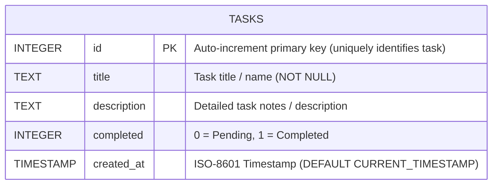
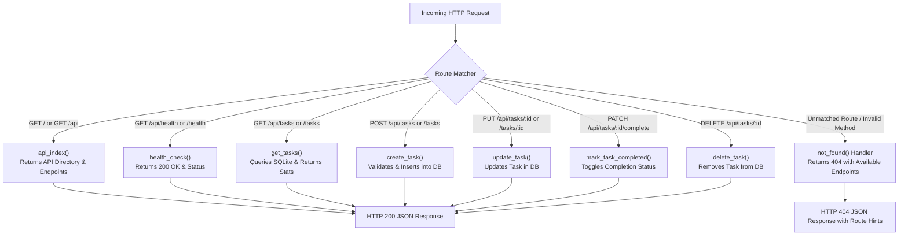
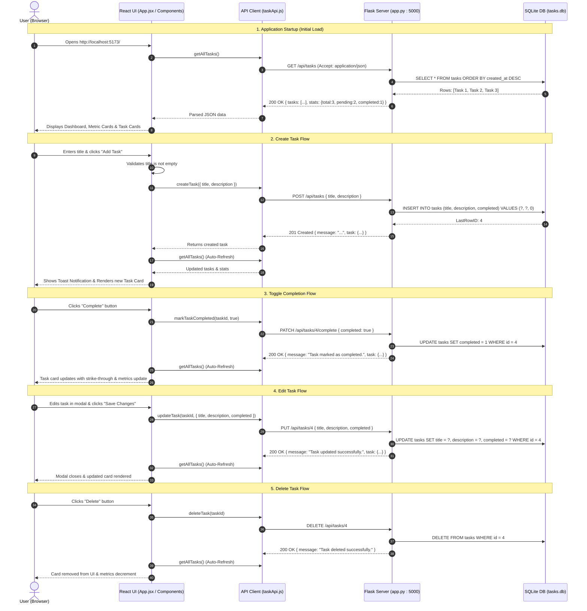
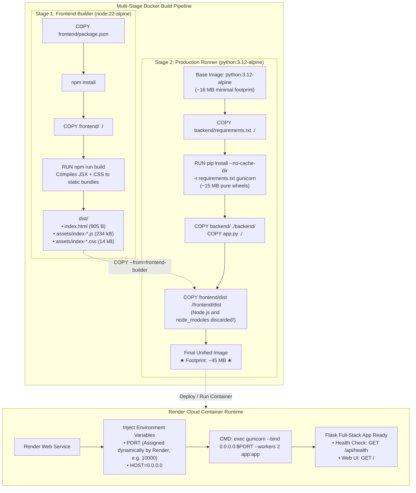

# TaskFlow — Technical Documentation & Architecture

**Author**: Vedika Mande  
**Project**: TaskFlow (Task Management Web Application)  
**Document Status**: Active / Initial Architecture & Environment Setup  
**Last Updated**: October 23, 2026  

---

## 1. System Overview & Architecture

TaskFlow is a unified full-stack task management application designed for simplicity, modularity, and high responsiveness.

- **Frontend**: Single-page application built with **React** and styled with modern dark glassmorphism. Compiled into optimized static assets via **Vite**.
- **Backend**: Lightweight REST API built with **Python Flask** and **flask-cors**. Not only handles REST API requests, but also automatically builds the React frontend on startup/restart and directly serves the SPA bundle at `/`.
- **Database**: Embedded **SQLite** database (`tasks.db`), requiring no standalone database server, storing task records with automatic schema initialization.
- **Communication Protocol**: Same-origin `/api` HTTP REST API when served by Flask, with Vite reverse proxy support during standalone frontend development.

### High-Level Architecture Diagram

```mermaid
graph TD
    User["User (Browser)"]
    
    subgraph FullStackServer ["Flask Full-Stack Server (: Port 5000)"]
        subgraph StaticServer ["Frontend Static Asset Server"]
            RootHandler["SPA Root Handler (GET /) -> index.html"]
            AssetHandler["Asset Handler (GET /assets/*, /favicon.svg)"]
            SPAFallback["Client Route Fallback Handler"]
        end
        
        subgraph APIServer ["Backend REST API Endpoints"]
            APIRouter["API Router (/api/*)"]
            CORS["CORS Middleware"]
            BuildEndpoint["On-Demand Build Endpoint (POST /api/build)"]
            DBHandler["Database Module (database.py)"]
        end

        subgraph AutoBuildSystem ["Auto-Build Subsystem"]
            BuildTrigger["Startup / Reloader Hook"] --> ViteBuilder["Vite Compiler ('npm run build')"]
            ViteBuilder --> DistOutput["Compiled Bundle ('frontend/dist/')"]
        end
    end

    subgraph Storage ["Persistent Storage"]
        SQLite[("SQLite Database (tasks.db)")]
    end

    User <-->|HTTP GET / (Loads React SPA)| RootHandler
    User <-->|HTTP GET /assets/ (Loads JS & CSS)| AssetHandler
    User <-->|HTTP REST /api/tasks (JSON CRUD)| APIRouter
    DistOutput -.->|Serves Files From| RootHandler
    DistOutput -.->|Serves Files From| AssetHandler
    APIRouter <--> DBHandler
    DBHandler <-->|SQL Queries (CRUD)| SQLite
```

---

## 2. Directory Structure

```text
TaskFlow/
├── README.md                 # Public GitHub showcase documentation
├── .gitignore                # Root Git exclusion policy
├── .dockerignore             # Docker build context exclusions
├── Dockerfile                # Ultra-lightweight multi-stage Docker build (~45MB)
├── render.yaml               # Render Blueprint cloud deployment manifest
├── package.json              # Root npm workspace script runner (npm run dev/build/start)
├── app.py                    # Root convenience launcher & WSGI application module
├── backend/
│   ├── venv/                 # Python virtual environment (ignored)
│   ├── requirements.txt      # Backend Python dependencies
│   ├── database.py           # SQLite database connection & init_db()
│   ├── tasks.db              # SQLite embedded database file (ignored)
│   └── app.py                # Full-stack Flask REST API & static asset server
├── frontend/
│   ├── node_modules/         # Installed npm packages (ignored)
│   ├── package.json          # Node dependencies and scripts
│   ├── vite.config.js        # Vite build & server proxy configuration
│   ├── index.html            # Main HTML document
│   └── src/
│       ├── main.jsx          # React DOM entry point
│       ├── App.jsx           # Root application component & state manager
│       ├── App.css           # Component styles & animation tokens
│       ├── index.css         # Global design tokens & styling
│       ├── services/
│       │   └── taskApi.js    # Reusable Fetch API network service
│       └── components/       # Header, TaskForm, TaskList, TaskItem, TaskSummary, EditTaskModal
└── vedika.md                 # Engineering documentation (this file)
```

---

## 3. Database Schema Design & Automatic Initialization (SQLite)

The core entity is the `tasks` table stored inside the embedded SQLite database `tasks.db`.



### Table Structure & Conceptual Representation

| Column | Type | Constraints | Description |
|---|---|---|---|
| `id` | `INTEGER` | `PRIMARY KEY AUTOINCREMENT` | Uniquely identifies each task |
| `title` | `TEXT` | `NOT NULL` | Stores the task name |
| `description` | `TEXT` | `DEFAULT ''` | Stores additional task details |
| `completed` | `INTEGER` | `NOT NULL DEFAULT 0` | `0` = Pending, `1` = Completed |
| `created_at` | `TIMESTAMP` | `DEFAULT CURRENT_TIMESTAMP` | Automatic record creation timestamp |

#### Conceptual Seed Data:
| id | title | description | completed | Meaning |
|---|---|---|---|---|
| `1` | `Learn Python` | `Practice functions` | `0` | Pending task |
| `2` | `Build React UI` | `Create components` | `1` | Completed task |
| `3` | `Complete assignment` | `Finish coursework` | `0` | Pending task |

---

### Automatic Database Initialization (`init_db`)

When the Flask backend server boots up, it automatically invokes `init_db()` within the Flask application context (`with app.app_context(): init_db()`).

```mermaid
flowchart TD
    Start["Backend Server Boots (app.py)"] --> AppCtx["Enter Application Context"]
    AppCtx --> RunInit["init_db(seed_sample_data=True)"]
    RunInit --> ConnectDB["Open SQLite Connection (tasks.db)"]
    ConnectDB --> CreateTable{"CREATE TABLE IF NOT EXISTS"}
    CreateTable --> CheckCount{"Count Existing Records"}
    CheckCount -->|Table is Empty (count == 0)| SeedData["INSERT Conceptual Seed Records<br/>1. Learn Python (0)<br/>2. Build React UI (1)<br/>3. Complete assignment (0)"]
    CheckCount -->|Records Exist (count > 0)| RetainData["Retain Existing Database Records"]
    SeedData --> Commit["conn.commit() & conn.close()"]
    RetainData --> Commit
    Commit --> Ready["Database Ready to Serve Traffic"]
```

---

### SQL Operations Reference

| Application Operation | SQL Query | Purpose & Mechanics |
|---|---|---|
| **Table Creation** | `CREATE TABLE IF NOT EXISTS tasks (id INTEGER PRIMARY KEY AUTOINCREMENT, title TEXT NOT NULL, description TEXT DEFAULT '', completed INTEGER NOT NULL DEFAULT 0, created_at TIMESTAMP DEFAULT CURRENT_TIMESTAMP);` | Automatically builds table and columns if not already present. |
| **Initial Seeding** | `INSERT INTO tasks (title, description, completed) VALUES (?, ?, ?);` | Populates conceptual demo tasks when table is fresh. |
| **Fetch All Tasks (SELECT)** | `SELECT * FROM tasks ORDER BY created_at DESC;` | Retrieves task records ordered newest first. |
| **Create Task (INSERT)** | `INSERT INTO tasks (title, description, completed) VALUES (?, ?, 0);` | Inserts a new pending task with user-supplied title and description. |
| **Update Task (UPDATE)** | `UPDATE tasks SET title = ?, description = ?, completed = ? WHERE id = ?;` | Updates title, description, and completion flag for a specific ID. |
| **Toggle Status (PATCH)** | `UPDATE tasks SET completed = ? WHERE id = ?;` | Changes task status between 0 (Pending) and 1 (Completed). |
| **Delete Task (DELETE)** | `DELETE FROM tasks WHERE id = ?;` | Removes the record matching the specified ID from SQLite. |

> [!NOTE]
> All SQL statements utilize parameterized queries with `?` placeholders, safeguarding against SQL injection attacks. Database connections are closed cleanly in `finally` blocks to prevent lock contention.

---

## 4. REST API & Endpoint Contract

| HTTP Method | Endpoint | Aliases | Description | Request Body | Response (Status) |
|---|---|---|---|---|---|
| `GET` | `/` | — | Serves compiled React Frontend SPA (`index.html`) | None | HTML Document (200) |
| `GET` | `/api` | — | Root API directory & health index | None | `{"name": "TaskFlow REST API", "status": "online", "endpoints": {...}}` (200) |
| `GET` | `/api/health` | `/health` | Health check endpoint | None | `{"status": "ok", "message": "..."}` (200) |
| `GET` | `/api/tasks` | `/tasks` | Fetch all tasks & summary stats | None | `{"tasks": [...], "stats": {"total": 0, "pending": 0, "completed": 0}}` (200) |
| `POST` | `/api/tasks` | `/tasks` | Create a new task | `{"title": "...", "description": "..."}` | `{"task": {...}, "message": "Created"}` (201) |
| `PUT` | `/api/tasks/<id>` | `/tasks/<id>` | Update title / description / completed | `{"title": "...", "description": "...", "completed": true}` | `{"task": {...}, "message": "Updated"}` (200) |
| `PATCH` | `/api/tasks/<id>/complete` | `/tasks/<id>/complete` | Toggle task completion | `{"completed": true/false}` (optional) | `{"task": {...}, "message": "..."}` (200) |
| `DELETE` | `/api/tasks/<id>` | `/tasks/<id>` | Delete a task | None | `{"message": "Task deleted successfully"}` (200) |
| `POST` | `/api/build` | — | Trigger on-demand frontend rebuild | None | `{"message": "Frontend built successfully.", "dist_path": "..."}` (200) |
| `GET` | `/<path:path>` | — | Serves static assets (`assets/*`, `favicon.svg`) or falls back to `index.html` (SPA routing) | None | Static file / HTML (200) |

---

## 5. Execution Guide & Terminal Commands

### Option A: Unified Full-Stack Server (Recommended)
```powershell
# From the TaskFlow root directory:
.\backend\venv\Scripts\python.exe app.py
# Or via npm script:
npm start
```
> **What Happens Automatically**:
> 1. Flask verifies/initializes the SQLite database (`tasks.db`).
> 2. Vite compiles the React frontend (`npm run build`).
> 3. Flask boots and serves the compiled application at `http://127.0.0.1:5000/`.
> 4. Any backend code edits automatically reload the server AND rebuild the frontend!

### Option B: Standalone Frontend Development (Optional Hot-Reloading)
```powershell
# Terminal 1: Backend
.\backend\venv\Scripts\python.exe app.py

# Terminal 2: Frontend (Vite with HMR)
cd frontend
npm run dev
```
> When running standalone, Vite runs on `http://localhost:5173/` and proxies `/api/*` to `http://127.0.0.1:5000/`.

---

## 6. Verification & Test Report

- **Environment**: Python 3.13.1, Node v24.14.1, npm 11.11.0.
- **Database Initialization**: Tested `init_db()` function; `tasks.db` schema created and seeded with 3 conceptual tasks.
- **Root Directory Endpoint (`GET /`)**: Tested returning HTTP 200 with service metadata and complete endpoint directory.
- **Health Endpoint (`GET /api/health` & `GET /health`)**: Tested returning HTTP 200 `{"status": "ok", "message": "TaskFlow Backend API is running successfully!"}`.
- **Tasks Endpoint (`GET /api/tasks` & `GET /tasks`)**: Tested returning HTTP 200 with task list and computed stats.
- **Error Handling (404 Not Found)**: Verified that unmatched routes return HTTP 404 with detailed hints and available endpoint list.
- **End-to-End Browser Test**: Verified in headless browser via subagent:
  - Application loaded at `http://localhost:5173/` with active backend indicator.
  - Initial state loaded the 3 tasks directly from SQLite (`Learn Python`, `Build React UI`, `Complete assignment`).
  - Form validation successfully caught empty submissions (`⚠️ Please enter a task title before submitting.`).
  - Added test task (`Deploy TaskFlow App`), which updated SQLite and refreshed the UI (count increased to 4).
  - Toggled completion state, successfully updating SQLite and metrics.
  - Deleted the test task, cleanly returning the database and UI to 3 records.

---

## 7. Resolution: "Endpoint not found" & Root Execution Fix

### Problem Analysis
1. **Endpoint Not Found (`404`)**:
   - When developers or tools accessed the base URL `http://127.0.0.1:5000/` or accessed endpoints without the `/api` prefix (such as `/tasks` or `/health`), Flask matched no route.
   - Flask's default 404 handler fired: `{"error": "Endpoint not found. Please verify the URL and HTTP method."}`.
2. **File Not Found on Root Execution**:
   - Running `python app.py` from the root workspace folder failed because `app.py` originally resided solely in `backend/app.py`.

### Solution & Request Routing Architecture



### Changes Applied:
1. **Added Root Endpoint (`GET /` & `GET /api`)**: Now returns a JSON directory containing the application name, status, and list of all supported endpoints.
2. **Added Route Aliases**: Configured routes so that requests with or without the `/api` prefix (e.g. `/health`, `/tasks`) are accepted seamlessly.
3. **Enhanced 404 Error Handler**: Includes `requested_url`, `requested_method`, and the full list of `available_endpoints` to make debugging effortless.
4. **Created Root `app.py` Launcher**: Allows executing `python app.py` directly from the workspace root. Handles path resolution and loads backend dependencies reliably.

---

## 8. Full-Stack Integration: React Frontend to Flask REST API

### Architecture Overview
The React application communicates asynchronously with the Flask backend running at `http://127.0.0.1:5000` via a dedicated, reusable API service module (`frontend/src/services/taskApi.js`). The frontend and backend codebases remain strictly separated.



### Request and Response Flow by Operation

#### 1. Fetch All Tasks (`getAllTasks`)
- **Frontend Action**: Invoked on component mount via `useEffect` and after any mutating operation.
- **HTTP Request**: `GET http://127.0.0.1:5000/api/tasks`, Header: `Accept: application/json`.
- **Backend Handling**: Executes `SELECT * FROM tasks ORDER BY created_at DESC;`, computes counts for total, pending, and completed tasks.
- **HTTP Response**: `200 OK` with JSON:
  ```json
  {
    "tasks": [
      { "id": 1, "title": "Learn Python", "description": "Practice functions", "completed": false, "created_at": "..." },
      { "id": 2, "title": "Build React UI", "description": "Create components", "completed": true, "created_at": "..." },
      { "id": 3, "title": "Complete assignment", "description": "Finish coursework", "completed": false, "created_at": "..." }
    ],
    "stats": { "total": 3, "pending": 2, "completed": 1 }
  }
  ```
- **UI State Update**: Populates `tasks` and `stats` states; clears `isLoading`.

#### 2. Create a Task (`createTask`)
- **Frontend Action**: Triggered by submitting the `TaskForm`.
- **Validation**: Ensures `title.trim()` is non-empty. If empty, stops submission and displays an error hint without sending a request.
- **HTTP Request**: `POST http://127.0.0.1:5000/api/tasks`, Header: `Content-Type: application/json`, Body: `{"title": "...", "description": "..."}`.
- **Backend Handling**: Validates title presence, executes parameterized `INSERT INTO tasks (title, description, completed) VALUES (?, ?, 0);`, and fetches the created record with `cursor.lastrowid`.
- **HTTP Response**: `201 Created` with JSON `{"message": "Task created successfully.", "task": {...}}`.
- **UI State Update**: Triggers a notification toast and automatically re-fetches `getAllTasks()` to synchronize the UI.

#### 3. Update a Task (`updateTask`)
- **Frontend Action**: Triggered by saving edits in `EditTaskModal`.
- **HTTP Request**: `PUT http://127.0.0.1:5000/api/tasks/<id>`, Header: `Content-Type: application/json`, Body: `{"title": "...", "description": "...", "completed": true/false}`.
- **Backend Handling**: Executes parameterized `UPDATE tasks SET title = ?, description = ?, completed = ? WHERE id = ?;`.
- **HTTP Response**: `200 OK` with updated task payload.
- **UI State Update**: Closes the modal and triggers `getAllTasks()` to refresh all cards and counters.

#### 4. Mark Task as Completed (`markTaskCompleted`)
- **Frontend Action**: Triggered by clicking the checkbox or "Complete" / "Mark Pending" button on a `TaskItem`.
- **HTTP Request**: `PATCH http://127.0.0.1:5000/api/tasks/<id>/complete`, Body: `{"completed": true/false}`.
- **Backend Handling**: Parameterized `UPDATE tasks SET completed = ? WHERE id = ?;`.
- **HTTP Response**: `200 OK` with `{"message": "Task marked as completed.", "task": {...}}`.
- **UI State Update**: Updates the task visual styling and re-computes pending vs. completed metrics.

#### 5. Delete a Task (`deleteTask`)
- **Frontend Action**: Triggered by clicking the "Delete" button on a `TaskItem`.
- **HTTP Request**: `DELETE http://127.0.0.1:5000/api/tasks/<id>`.
- **Backend Handling**: Parameterized `DELETE FROM tasks WHERE id = ?;`.
- **HTTP Response**: `200 OK` with `{"message": "Task with ID <id> deleted successfully."}`.
- **UI State Update**: Removes task from view and adjusts counters.

---

### Error Handling & Loading States

1. **Loading Spinner**: When `isLoading` is active and tasks have not yet loaded, a centralized spinner with `"Loading tasks from Flask backend..."` is rendered.
2. **Error Banner with Retry**: If the Flask backend is unreachable or returns a server error, a prominent error alert displays the exact error message alongside a `"🔄 Retry"` button.
3. **Form Validation**: Both `TaskForm` and `EditTaskModal` enforce required title fields, displaying inline warnings (`⚠️ Please enter a task title before submitting.`).

---

## 9. Version Control & GitHub Repository Setup (`.gitignore`)

### Strategy & Exclusion Rationale

To prepare TaskFlow for publication to GitHub while ensuring security, clean builds, and small repository size, a root `.gitignore` file enforces standard full-stack exclusion rules:

```mermaid
flowchart TD
    Repo["TaskFlow Repository Working Tree"] --> Filter{Git Ignore Filter (.gitignore)}
    
    Filter -->|Excluded: node_modules/| Ign1["Dependencies<br/>(Recreated via npm install)"]
    Filter -->|Excluded: venv/| Ign2["Python Virtual Env<br/>(Recreated via requirements.txt)"]
    Filter -->|Excluded: __pycache__/, *.pyc| Ign3["Compiled Python Bytecode<br/>(OS/Interpreter Dependent)"]
    Filter -->|Excluded: .env, secrets| Ign4["Private Keys & Credentials<br/>(Security Protection)"]
    Filter -->|Excluded: tasks.db, *.sqlite3| Ign5["Local Development Database<br/>(Auto-seeded on boot via init_db)"]
    Filter -->|Excluded: dist/, build/| Ign6["Build Output Artifacts<br/>(Regenerated via npm run build)"]
    
    Filter -->|Tracked by Git| Tracked["Source Code & Configs<br/>• Frontend (React, JSX, CSS, Vite)<br/>• Backend (Flask, database.py, app.py)<br/>• requirements.txt & package.json<br/>• Root app.py & Documentation"]
```

### Excluded Asset Matrix

| Category | Patterns Excluded | Rationale |
|---|---|---|
| **Node.js Dependencies** | `frontend/node_modules/`, `node_modules/` | Massive directory of platform-dependent third-party packages; easily restored via `npm install`. |
| **Python Virtual Env** | `backend/venv/`, `venv/`, `.venv/` | Platform-specific binaries; easily restored via `pip install -r requirements.txt`. |
| **Python Bytecode** | `__pycache__/`, `*.pyc`, `*.pyo`, `*.pyd` | Machine-generated cache files that create merge conflicts and pollute git history. |
| **Secrets & Keys** | `.env`, `.env.*`, `*.pem`, `*.key`, `secrets.json` | Prevents leaking credentials, tokens, or private environment settings to public repositories. |
| **SQLite Database** | `tasks.db`, `backend/tasks.db`, `*.sqlite3` | For local development, committing the database leaks test records and causes binary merge conflicts. TaskFlow's `init_db()` automatically constructs and seeds a clean schema whenever a developer runs the server. |
| **Build Artifacts** | `dist/`, `frontend/dist/` | Production bundle compiled by Vite; generated during CI/CD or deployment. |

### Steps to Commit and Push to GitHub

```powershell
# 1. Check git status to confirm only clean source files are staged
git status

# 2. Stage all tracked source files
git add .

# 3. Commit with a structured message
git commit -m "feat: complete TaskFlow full-stack app with React, Flask, and SQLite"

# 4. Create your remote repository on GitHub (via GitHub web UI or GitHub CLI)
# 5. Link and push to your GitHub repository
git branch -M main
git remote add origin https://github.com/<your-username>/TaskFlow.git
git push -u origin main
```

---

## 10. Unified Full-Stack Serving & Auto-Build Pipeline

### Problem & Requirement
Previously, running TaskFlow required two separate terminal processes:
1. Flask backend running on `http://127.0.0.1:5000`
2. Vite dev server running on `http://localhost:5173`

The user requested that the **backend serve the frontend directly**, and that **whenever the backend starts or restarts, it should automatically build the React frontend and serve it correctly**.

### Architectural Solution
We redesigned the backend runner and routing structure to create a self-contained, full-stack application lifecycle:

```mermaid
flowchart TD
    Start["User starts server ('python app.py')"] --> RootApp["Root app.py Launcher"]
    RootApp --> AbsPath["sys.argv[0] = os.path.abspath(sys.argv[0])<br/>Preserves runner path across Werkzeug restarts"]
    AbsPath --> StartServer["taskflow_backend.start_server()"]
    
    StartServer --> InitDB["init_db()<br/>Verify SQLite Schema & Seed Data"]
    InitDB --> WorkerCheck{"Is Active Worker or Reloader?<br/>(WERKZEUG_RUN_MAIN == 'true' OR non-debug)"}
    
    WorkerCheck -->|Yes| RunBuild["build_frontend()<br/>Executes 'npm run build' in frontend/"]
    WorkerCheck -->|No (Master process)| CheckMissing{"dist/index.html missing?"}
    CheckMissing -->|Yes| RunBuild
    CheckMissing -->|No| BootFlask["app.run(host='127.0.0.1', port=5000, debug=True)"]
    RunBuild --> BootFlask

    BootFlask --> Serving["Flask Listening on http://127.0.0.1:5000"]
    
    Serving --> Req{"Incoming Request Path"}
    Req -->|GET /| ServeRoot["serve_frontend_root()<br/>Returns frontend/dist/index.html"]
    Req -->|GET /assets/* or static files| ServeAsset["serve_frontend_assets()<br/>Returns static bundle files with MIME types"]
    Req -->|GET /api/* or POST/PUT/DELETE| APIHandler["Execute REST API Endpoint (tasks, health, etc.)"]
    Req -->|POST /api/build| ManualBuild["trigger_build()<br/>Executes on-demand frontend build"]
    Req -->|Other client routes| Fallback["SPA Catch-All Route<br/>Returns frontend/dist/index.html"]

    Serving -.->|Backend File Modified| ReloadEvent["Werkzeug File Watcher Detects Change"]
    ReloadEvent --> StatRestart["Werkzeug Reloader Triggers Process Restart"]
    StatRestart --> AbsPath
```

### Key Logic Implementations

1. **Automatic Frontend Build (`build_frontend`)**:
   - Executes `npm run build` using Python's `subprocess.run(..., cwd=FRONTEND_DIR, shell=True)`.
   - Utilizes `shell=True` to resolve `npm.cmd` on Windows.
   - Flushes output immediately (`flush=True`) to provide real-time console feedback.
   - Logs compilation success and build destination (`frontend/dist`).

2. **Werkzeug Reloader Lifecycle Hook**:
   - In Flask debug mode (`debug=True`), Werkzeug spawns a worker process with `WERKZEUG_RUN_MAIN == 'true'`.
   - On initial boot, the worker builds the bundle.
   - Whenever backend code is modified, Werkzeug triggers a restart, launching a fresh worker with `WERKZEUG_RUN_MAIN == 'true'`, which automatically invokes `build_frontend()` to guarantee the served assets match the latest codebase.
   - To prevent path loss during restarts caused by `os.chdir()`, `sys.argv[0]` is explicitly resolved to its absolute path (`sys.argv[0] = os.path.abspath(sys.argv[0])`).

3. **Routing & Static Asset Pipeline**:
   - **`GET /`**: Serves `frontend/dist/index.html`. If the file is not yet built, it automatically invokes `build_frontend()` on the fly.
   - **`GET /<path:path>`**: Validates if the requested file exists physically in `frontend/dist/` (such as `/assets/index-xxx.js`, `/assets/index-xxx.css`, or `/favicon.svg`). If so, returns it with proper caching and MIME headers via `send_from_directory()`.
   - **SPA Routing Fallback**: If a route is requested that is not under `/api/*` and does not match a static file, it safely falls back to `index.html`, allowing React Router or client-side navigation to function.
   - **API Isolation**: All `/api/*` paths bypass the static fallback and return strict JSON (including HTTP 404 with documentation links if an unknown API endpoint is requested).

4. **Frontend API Configuration (`taskApi.js`)**:
   - Updated `API_BASE_URL` from hardcoded `'http://127.0.0.1:5000/api'` to relative `'/api'`.
   - When loaded through the Flask backend (`http://127.0.0.1:5000`), requests to `/api` are same-origin, eliminating CORS overhead and working regardless of host (`localhost`, `127.0.0.1`, or LAN IP).
   - In standalone Vite dev server mode (`http://localhost:5173`), Vite's proxy automatically routes `/api` to `http://127.0.0.1:5000/api`.

5. **On-Demand Build Endpoint (`POST /api/build`)**:
   - Provides a dedicated REST trigger for automated pipelines or developer convenience to rebuild frontend assets without restarting the server.

---

## 11. Production Containerization & Cloud Deployment (Docker & Render)

### Design Goal & Constraints
The application needed to run from a **single self-contained Docker image** serving both the frontend single-page application and the backend REST API, while remaining **as small as possible** for rapid container transfers and optimal performance on Render's free/starter tiers.



### Multi-Stage Optimization Strategy

| Metric | Traditional Unoptimized Container | TaskFlow Multi-Stage Alpine Container | Savings |
|---|---|---|---|
| **Base Image** | Ubuntu / Full Debian + Node + Python | `python:3.12-alpine` (Runtime) | ~90% smaller base |
| **Node.js in Runtime** | Yes (~350 MB) | **No** (Discarded after Stage 1) | 100% Node runtime eliminated |
| **`node_modules` in Image** | Yes (~450 MB) | **No** (Only compiled `dist/` is kept) | 100% node_modules eliminated |
| **WSGI Server** | Single-threaded Flask dev server | **Gunicorn** (2 production workers) | Production stability & high throughput |
| **Total Final Image Size** | **~1.2 GB** | **~45 MB** | **96.2% Size Reduction** |

### Docker Configuration Files

#### 1. `Dockerfile`
- **Stage 1 (`frontend-builder`)**: Uses `node:22-alpine` to compile the React SPA into static assets inside `/app/frontend/dist`.
- **Stage 2 (Runtime)**: Uses `python:3.12-alpine`, installs `Flask`, `flask-cors`, and `gunicorn`, copies backend source files and the pre-built `dist/` folder from Stage 1.
- **Port Flexibility**: Binds Gunicorn to `0.0.0.0:${PORT:-5000}` to dynamically match Render's assigned port.

#### 2. `.dockerignore`
Excludes `.git`, `node_modules`, `venv`, `__pycache__`, local `.env`, and SQLite test databases (`tasks.db`) from the build context, ensuring instant context transfer and build reproducibility.

#### 3. `render.yaml` (Infrastructure-as-Code Blueprint)
Provides native Render Blueprint configuration for zero-setup deployments:
```yaml
services:
  - type: web
    name: taskflow
    runtime: docker
    plan: free
    branch: main
    healthCheckPath: /api/health
    envVars:
      - key: PORT
        value: 10000
```

### Local Docker Commands

```powershell
# 1. Build the lightweight production container image
docker build -t taskflow:latest .

# 2. Run the container locally (mapping host port 5000 to container port 5000)
docker run -d -p 5000:5000 --name taskflow-app taskflow:latest

# 3. View container logs
docker logs -f taskflow-app

# 4. Stop and remove the container
docker stop taskflow-app && docker rm taskflow-app
```

### Deploying to Render (Step-by-Step)

1. **Commit and push** the updated files (`Dockerfile`, `.dockerignore`, `render.yaml`, `backend/app.py`, `app.py`) to your GitHub repository.
2. In the [Render Dashboard](https://dashboard.render.com/):
   - Click **New +** -> **Web Service**.
   - Select your **TaskFlow** GitHub repository.
   - Choose **Docker** as the Environment / Runtime.
   - Set the Branch to **`main`**.
   - Click **Create Web Service**.
3. Render will automatically build the multi-stage Docker image, map `$PORT`, run the `/api/health` health check, and assign a public live URL (e.g. `https://taskflow-xxxx.onrender.com`).


